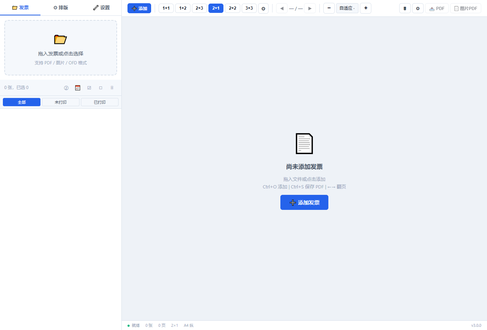
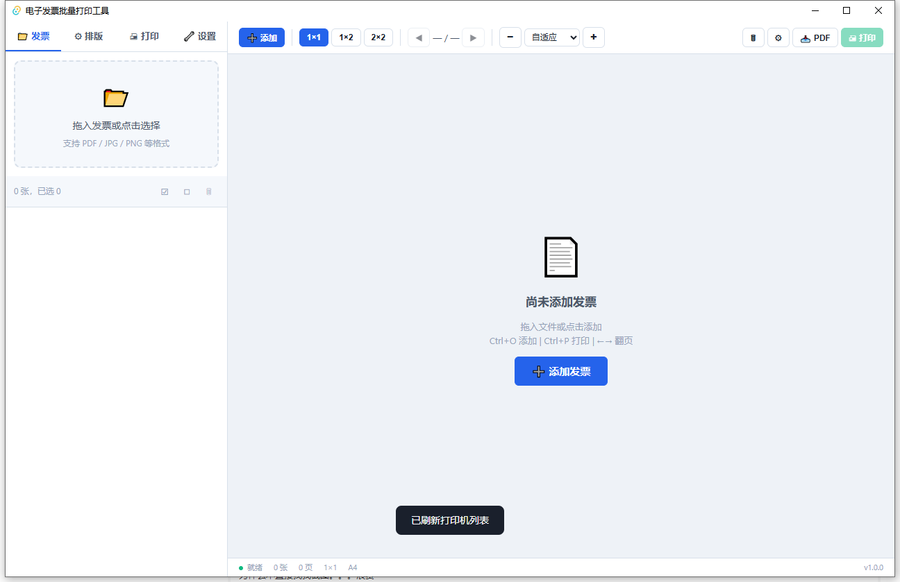

# 📄 发票酱

[](LICENSE)
[]()
[]()
[]()

轻量桌面应用，专为批量打印电子发票设计。支持 PDF、OFD、图片等多格式导入，智能排版，一键打印或导出。

提供 **轻量版** 和 **OCR 版**（含 PP-OCRv6 智能识别），单文件 exe 即开即用。

## ✨ 功能特性

### 🏆 OFD 完整支持

OFD（开放版式文档）是国家标准电子发票格式。本工具提供原生支持——矢量渲染、发票信息直提、印章保真，拖入即用，无需 OCR。

- **文字定位兼容**：自动判定「空格参与字距」与「空格是列分隔」两种字距写法；多行文字按完整字符流定位；支持 `\XXXX` 十六进制转义、单个文本对象内多段文字独立排版、`¤` 占位符占位不绘制——不同厂商生成的 OFD 不再错位、错码、叠字
- **厂商差异适配**：税务原版、iloveofd 转换、dzcp 公共服务平台等格式均已适配；遇到解析渲染问题欢迎反馈
- **诊断导出**：右键文件 →「📤 导出诊断信息」，一键生成脱敏结构报告（不含原文内容），贴进 issue 即可帮助定位

### 📥 文件管理

- **多格式支持**：PDF、OFD、XML 数电票、JPG、PNG、BMP
- **XML 数电票**：解析 `<EInvoice>` 格式，提取发票号码 / 日期 / 金额 / 买卖方信息，汇总表、CSV 导出、批量重命名全兼容；纯数据格式不参与排版打印
- **文件列表记忆**：可选开关，启动时自动恢复上次打开的文件列表，仅记忆文件路径
- **三维正交筛选**：类型（专票 / 普票 / 车票 / 通行费 / 医疗 / 非税 / 其他）× 格式（PDF / OFD / 图片 / XML）× 状态（全部 / 未打印 / 已打印 / 重复）自由组合，全选遵循当前筛选；筛选「车票」→ 全选 → 打印，再筛「专票」→ 全选 → 打印，即可分类分批排版。工具栏与筛选区固定在列表顶部，筛选区可折叠
- **打印状态追踪**：打印后自动标记绿色 ✓，状态持久化
- **PDF 渲染双引擎**：首选 WinRT 原生渲染（`Windows.Data.Pdf`），自动 fallback PDFium（Chromium 内核），兼容企业精简版 / LTSC 系统
- **PDF 文字层提取**：解析 PDF 内容流直接提取文字坐标，约 5ms/页，无需 OCR 即可识别发票信息（轻量版也可用）
- **PP-OCRv6 智能识别**（OCR 版）：文本优先 + 坐标回退双重架构，含税价 / 不含税价 / 税额数学验证配对，发票号码 / 日期 / 买卖方信息自动提取
- **票种识别**：专票 / 普票 / 车票 / 通行费 / 医疗收费票据 / 非税收入票据自动分类并显示徽章；通行费发票保留路桥公司销售方名称，医疗票据识别明细页并从排版移除
- **金额校验可视化**：金额求和校验失败时卡片显示 ⚠ 警告，hover 查看含税 / 不含税 / 税额验证详情
- **EXIF 方向自动修正**：导入图片时自动读取 EXIF Orientation 旋转像素；PDF `/Rotate` 属性 + CropBox 坐标归一化保障页面方向正确
- **发票查验**：一键跳转国家税务总局查验平台
- **骨架屏渐进加载**：批量导入时骨架屏秒出 + 逐文件渐进渲染 + 持久进度 toast，大文件不卡 UI
- **排序**：日期排序（旧→新 / 新→旧，空日期排末尾）、按发票类型分组排序（专票→普票→通行费→医疗→非税→车票→其他，跨页票整组不拆散）
- **右键菜单**：文件列表与预览槽位共用完整菜单——排版份数、旋转 90°、OCR 识别、复制发票信息、单票调整（重置此票 / 居中 / 应用到全部 / 重置全部调整）、删除；右键同步选中态
- **单票浮动工具条**：选中版面发票后浮出——重置 / 居中 / 应用到全部 / 份数 / 旋转（显示当前角度）/ 删除；自动避开相邻格与预览区边界，格子过窄时只留图标
- **预览多选**：Ctrl+点击或预览空白处拖框多选（限当前页），工具条操作、滚轮缩放对全部选中票同步生效
- **版面拖拽排序**：预览区拖动发票到另一槽位——拖到边缘顺位插入，拖到中间两张对调
- **列表拖拽排序 + 临时占位留白**：左侧列表拖动调整打印顺序，与版面联动；按下版面尾部空槽拖到发票之间即创建空白留白
- **缩略图方格视图**：列表可切换卡片式方格视图，显示缩略图与金额 / 份数 / 重复 / 已打印标记，视图选择持久化
- **批量重命名**：汇总表内嵌面板，预设模板或自定义字段勾选，一键重命名磁盘文件，重名自动序号
- **多页发票逻辑票聚合**：同批次同一 PDF、发票号一致的多页视为一张跨页票——显示「续 n/N」「共 N 页」徽章，统计只计合计页金额，去重按整组计数与删除，避免续页被误删导致打印缺页
- **重复发票识别与去重**：按发票号检测可靠重复，支持「添加时自动去重」与「重复」筛选一键勾选删除；无发票号时按 销售方 + 金额 + 日期 仅作 ⚠ 疑似标记，不自动删除，避免误删同日同额的真发票
- **空白槽位上传**：版面空白格子显示加号，点击上传并精准落位（支持版面中间留白，占位可替换 / 删除）
- **设置自动记忆**：关闭后自动记住布局、纸张、打印模式等全部设置，打开即恢复
- **设置导出 / 导入**：导出完整配置（排版 / 纸张 / 边距 / 水印 / 页脚 / 粘贴单 / 打印 / 识别 / 主题等设置，含已打印标记、文件列表、单票调整、备注等本地记忆）为 JSON；导入一键恢复并自动重载，换机迁移、配置备份直接用

### 📐 排版设置

- **纸张**：A4 / A5 / B5 / Letter / Legal / 自定义；另有证件照预设（小一寸 22×32、一寸 25×35、大一寸 33×48、小二寸 35×45、二寸 35×49、身份证照片·社保卡 26×32，单位 mm，括号内标注常用场景，选中自动转纵向）与 5 寸 / 6 寸相纸；尺寸支持毫米 / 像素（300DPI）单位切换
- **相纸模式**：与报销单 / 粘贴单并列的独立版式。选好相纸与证件照规格后按照片实际尺寸整版居中排列——自动铺满或手动指定列×行，默认间距 2mm、留边 3mm，提供「常用张数」一键按钮（4 / 6 / 8 / 9 / 12 / 16），也可拼「身份证 85.6×54mm」实际卡片尺寸；切割线随「裁切线」开关显示，放不下的张数会禁用
- **报销单分段模式**：单列 N 段（默认段高 120mm）连续排列，发票纵向贴段顶、水平对齐可配（靠左 / 居中 / 靠右），裁切线按分段固定位置绘制
- **粘贴单模式**：表单式整页版式，票据只排在装订线上方、签字栏下方；装订线文字与字号可配，右下角签字栏支持列名 / 宽度 / 行高设置，留空打印后手写
- **布局**：6 个固定预设 + 自定义行列（1-10 × 1-10），自动横纵方向
- **快捷布局**：顶部快捷按钮默认 1×1 / 1×2 / 2×3 / 2×1 / 2×2 / 3×3 / 4×5，可增删、编辑、排序并限制显示数量，配置自动记忆
- **边距 / 间距**：独立可调，预设快捷按钮
- **缩放**：自适应 / 拉伸填充 / 原始大小 / 自定义百分比，预览缩放级别随设置记忆
- **旋转**：全局 0° / 90° / 180° / 270° / 自动 + 单张旋转
- **单票独立调整**：每张发票预览拖拽移动 + 角落 handle 缩放，九宫格快速对齐，滚轮微调、选中后滚轮缩放单票（5%/步），偏移范围 ±150mm、放大上限 5x，编辑态溢出可见，调整参数可选持久化，PDF 按参数裁剪输出
- **防误触**：侧栏滚轮需点击激活输入框后才生效，滚动浏览不误改设置；「恢复默认」分「仅恢复版面」与「恢复全部」两档

### ✂️ 辅助功能

- 裁切线、编号标记、边框显示、自定义水印
- **裁剪白边**：自动裁掉发票图片内部的纯白边，留边 0–60 可配置，PDF 矢量裁切与预览一致
- **文本增强**：浅色 / 模糊图片一键增强（色阶拉伸 + 中间调压暗 + USM 锐化），全程本地处理，红章不偏色
- **清晰度体检与自动增强**：按折算打印 DPI 标记低清晰度发票；开启自动增强后，打印 / 保存时对所有图片源自动增强
- **项目名称 / 发票备注识别**：自动提取明细行「项目名称」（数电票 `*类别*品名` 还原为 `【类别】品名`，多条用「、」合并）与票面「备注」栏，可用于批量重命名与汇总表；版式不固定，取不到就留空，结果可在发票弹窗人工修正。覆盖图片 OCR / PDF 文字层 / OFD / XML 数电票
- **副本标记**：同发票多副本在槽位左上角显示 n/N 序号，跨页也能核对
- 金额统计、票种标签（专票 / 普票 / 车票 / 通行费 / 医疗 / 非税同形异色 chip）
- **页脚**：打印页码（第 X 页 / 共 Y 页）、打印日期、自定义页脚文本，独立下边距控制

### 📊 数据导出

- **发票汇总表**：报销必备，一键查看所有发票明细，16 个字段按需勾选（含项目名称 / 发票备注），金额 / 名称等可直接编辑修正，合计行自动汇总含税 / 不含税 / 税额，CSV 格式 Excel 直接打开，列选择持久化记忆
- 多页发票只计合计页金额；长数字（≥15 位，如 20 位发票号）按文本导出，Excel / WPS 打开不变科学计数法、不丢精度

### 🖨️ 打印与导出

- **四种打印模式**
  - **PDF 阅读器**：生成 PDF 后由系统默认程序处理，保持矢量质量，数据量最小
  - **弹窗确认**：预览后确认打印，可选 PDFium 或 SumatraPDF 引擎
  - **静默打印（PDFium，默认）**：Chromium PDFium 引擎直打打印机 DC，打印清晰（需下载 pdfium.dll）
  - **静默打印（SumatraPDF）**：通过 SumatraPDF 直接发送到打印机（需安装 SumatraPDF）
- **PDF 统一直通**：lopdf Form XObject + JPEG DCTDecode 直通，PDF 页面以原始质量嵌入合成 PDF，无二次压缩
- **印章烘焙**：生成 PDF 时自动将原票印章 / 签章标注烘焙到输出，位置 / 大小与原票一致
- **份数控制**：全局份数 + 单票份数，逐份 / 逐页打印，双面打印，彩色 / 灰度 / 黑白
- **双面 + 逐份隔离**：同时开启时按源文件边界自动插入空白分隔页，保证每份从纸张正面开始，末尾补齐偶数页
- **PDF 导出**：自动打开或自定义保存目录，可自选页码范围（全部 / 当前页 / 指定范围）
- **老打印机兼容模式**（默认关）：将打印 / 保存的 PDF 整页栅格化为纯位图 PDF（PDF 1.4 + 经典 xref 表，无透明、无嵌入字体），老式打印机不再丢字丢章；需 PDFium 组件
- **打印确认弹窗**：显示发票数量 / 版面 / 纸张 / 打印机 / 引擎 / 份数 / 自动补入的空白页，防止误操作

### 🎨 界面

- 深色 / 浅色模式、实时预览（缩放 + 翻页 + 滚轮翻页）
- **列表 ↔ 版面双向联动**：点击列表发票跳页并选中对应槽位，选中槽位反向高亮列表
- **快捷键**：`Ctrl+O` 添加 · `Ctrl+P` 打印 · `Ctrl++/-` 缩放 · `Ctrl+0` 自适应 · `←→` 翻页 · 滚轮翻页 · 槽位上滚轮缩放单票

## 📸 界面预览

<table>
  <tr>
    <td align="center">☀️ 浅色模式</td>
    <td align="center">🌙 深色模式</td>
  </tr>
  <tr>
    <td></td>
    <td></td>
  </tr>
</table>

## 📦 下载

从 [Releases](../../releases) 下载最新版本：

| 文件 | 说明 |
|------|------|
| `TicketChan_<版本>_x64-setup.exe` | 轻量版安装包 |
| `TicketChan_<版本>_x64_portable.exe` | 轻量版便携（单文件 exe，无需安装） |
| `TicketChan_<版本>_x64_ocr-setup.exe` | OCR 版安装包（含 PP-OCRv6） |
| `TicketChan_<版本>_x64_ocr-portable.zip` | OCR 版便携（exe + models/） |

> 💡 文字型 PDF / OFD 发票选轻量版即可自动提取金额和销售方信息；图片型 PDF 和图片需 OCR 版。

> ⚡ **应用内更新**：发现新版本时可点「下载并更新」，自动校验、替换并重启，无需手动下载整包。设置中可切换正式版 / 测试版更新渠道。

**系统要求**：仅支持 **Windows 10 1803 及以上版本** 或 **Windows 11**。

**⚠️ 不支持 Windows 7/8**：依赖的 WebView2 和系统 PDF 组件已停止支持，无法正常运行。

> 💡 如遇「找不到 WebView2」报错，说明系统未安装或已被卸载。请从 [微软官网](https://go.microsoft.com/fwlink/p/?LinkId=2124703) 下载 **Evergreen 引导程序**（约 2MB），安装后重启应用即可。

## 🌐 Web 版

同时提供纯前端 Web 版，零后端零构建，浏览器即开即用。与桌面版同一套代码核心，无需安装、无需 Rust 编译器。

> **🕸️ 在线试用**：[https://fapiao.erma0.cn](https://fapiao.erma0.cn)

源码见 [`web` 分支](https://github.com/erma0/fapiao-print/tree/web)，可自行部署到任意静态托管（Vercel / Netlify / Cloudflare Pages / GitHub Pages / 内网 nginx 等）。

### 与桌面版的差异

| 功能 | 桌面版 (Tauri) | Web 版 |
|------|----------------|--------|
| PDF 打印 | 4 引擎可选（PDF 阅读器 / 确认弹窗 / PDFium / SumatraPDF） | 浏览器 `<iframe>.print()` |
| 静默打印 | ✅ 支持（直打打印机 DC） | ❌ 必须经过浏览器打印弹窗 |
| 打印机选择 | ✅ 可指定打印机 | ❌ 只能系统默认 |
| 批量重命名文件 | ✅ 访问文件系统 | ❌ 浏览器安全限制 |
| 文件列表记忆 | ✅ 跨会话恢复 | ❌ 不支持 |
| 矢量 PDF CJK 文字 | ✅ PDFium 引擎完整保真 | ⚠️ 部分嵌入字体可能缺失（可用「保存图片 PDF」兜底）|
| OCR | ✅ PP-OCRv6 智能识别（OCR 版） | ❌ 无 OCR |
| 离线部署 | ✅ 单文件 exe | ✅ 纯离线，零网络 |

## 📋 使用说明

1. **添加发票**：点击「➕ 添加」或拖放文件（支持 PDF / OFD / 图片混选）
2. **排版设置**：左侧「⚙ 排版」面板调整纸张、布局、边距
3. **预览检查**：主区域实时预览，支持缩放翻页；文字型 PDF / OFD 自动提取金额信息，图片型 PDF 和图片需 OCR 版
4. **打印**：点击「🖨 打印」，选择弹出预览或直接打印
5. **保存 PDF**：点击「📥 PDF」导出合成 PDF

## 🛠 技术栈

| 层级 | 技术 | 说明 |
|------|------|------|
| 前端 | 原生 HTML/CSS/JS | 模块化（app / ocr / layout / print），零依赖框架 |
| 后端 | Tauri 2.x (Rust) | 轻量桌面框架，Rust 条件编译管理功能开关 |
| PDF 渲染 | WinRT + PDFium 双引擎 | WinRT 原生渲染优先，自动 fallback PDFium（Chromium 内核） |
| PDF 生成 | printpdf 0.9 + lopdf 0.39 | JPEG 直通零质量损失、PDF 页面 Form XObject 全布局直通 |
| OFD/XML 解析 | Rust 独立 crate (`invoice-engine/`) | 矢量 SVG 渲染 + 发票 XML / 数电票字段直提 + 印章偏移叠加 + 文字排版兼容 |
| OCR | ocr-rs 2.4 (PP-OCRv6 + MNN) | 文本优先 + 坐标回退，对比度增强，Lanczos3 锐化（OCR 版可选） |
| 图像处理 | image 0.25 (Rust) | JPG / PNG / BMP 解码，kamadak-exif 方向自动修正 |
| 打印 | PDFium + SumatraPDF + Print Spooler API + ShellExecuteW (Win32) | 静默打印、弹窗确认、PDF 阅读器 |

## 📁 项目结构

```
ticketchan/
├── src/                            # 前端
│   ├── index.html / styles.css
│   ├── app.js                      # 主入口、状态、文件加载、列表与设置
│   ├── ocr.js                      # 发票字段提取（OCR / PDF 文字层）
│   ├── layout.js                   # calculateLayout() + 预览渲染与交互
│   └── print.js                    # 打印 / 导出 PDF / 智能缓存
├── src-tauri/                      # Tauri / Rust 后端
│   ├── src/
│   │   ├── main.rs                 # 入口
│   │   ├── lib.rs                  # IPC 命令层
│   │   ├── pdf_engine.rs           # PDF 生成、WinRT 渲染
│   │   ├── pdfium_print.rs         # PDFium 矢量直打
│   │   ├── updater.rs              # 应用内自更新
│   │   ├── diagnostics.rs          # 诊断导出
│   │   └── seh_wrapper.c           # SEH 崩溃保护
│   ├── invoice-engine/             # 发票引擎独立 crate（OFD 渲染 + XML 解析）
│   ├── models/                     # PP-OCRv6 MNN 模型（OCR 版打包用）
│   ├── Cargo.toml                  # ocr feature flag
│   ├── tauri.conf.json             # 轻量版配置
│   └── tauri.ocr.conf.json         # OCR 版配置（含 models）
├── scripts/
│   ├── build-all.js                # 一键全量构建（4 产物）
│   ├── test-regressions.js         # 浏览器回归与真实样本字段验证
│   └── bump-version.js             # 版本号同步
└── package.json
```

## 🚀 开发

**环境要求**：Node.js 18+、Rust 1.77+、Windows 10/11

```bash
npm install

# 开发
npm run dev          # 轻量版
npm run dev:ocr      # OCR 版

# 构建
npm run build        # 轻量版
npm run build:ocr    # OCR 版
npm run build:all    # 一键全量构建（4 产物）

# 前端回归测试（Node.js 22+，本机 Chrome / Edge）
npm test

# 版本号
npm run bump 2.7.1   # 同步 package.json → Cargo.toml → tauri.conf.json
```

测试无需安装额外 npm 库，使用独立的临时浏览器配置，可通过 `TICKETCHAN_TEST_BROWSER` 指定 Chromium 路径；真实样本的提取、预期值和验证方法见 [测试说明](docs/testing.md)。

## 📚 相关文档

- [更新日志](CHANGELOG.md)：各版本新增、修复与优化记录
- [测试说明](docs/testing.md)：浏览器回归与真实样本字段验证

## 📄 许可证

[MIT License](LICENSE)

## Star History

[](https://star-history.com/#erma0/fapiao-print&Date)
